<!-- Section A: Animated Visual Hero -->

  

<!-- Section B: Genuine Interactive 3D WebGL Gateway -->
### 🪐 Interactive 3D WebGL Experience

*Explore genuine Three.js celestial nodes, orbital camera mechanics, raycast inspection, and architectural telemetry directly in your browser.*

  

---

### 🚀 Selected Core Engineering

*Pinned repositories below highlight active codebases. Core highlights and verified benchmarks:*

- **[cv-template](https://github.com/Rana0Codes/cv-template)** — Privacy-first ATS resume and Indian biodata builder with native A4 vector print engine. 100% client-side computation. • [Live Demo](https://rana0codes.github.io/cv-template/)
- **[smart-image-document-detector](https://github.com/Rana0Codes/smart-image-document-detector)** — In-browser document vs. photograph classifier with MobileNetV2 UINT8 quantization. 16.2–18.4ms client WebGL inference.
- **[Anime-Recommendation-Generator](https://github.com/Rana0Codes/Anime-Recommendation-Generator)** — AniList GraphQL recommendation engine with custom themes and 1080p Full HD poster export.
- **[Portfolio-v2 (Juyel.OS)](https://github.com/Rana0Codes/Portfolio-v2)** — VisionOS-inspired multi-window web desktop with Web Audio API synthesizer and Three.js 3D Universe. • [Live Desktop](https://rana0codes.github.io/Portfolio-v2/)

---

<!-- Section D: Activity Overview Graph (Downside) -->

  

<!-- Section E: Minimal Closing -->
<a href="https://rana0codes.github.io/Portfolio-v2/"><b>Explore Portfolio (Juyel.OS)</b></a> &bull; 
<a href="https://www.linkedin.com/in/juyel-rana/"><b>LinkedIn Profile</b></a> &bull; 
<a href="https://github.com/Rana0Codes"><b>GitHub @Rana0Codes</b></a>

  
<i>Kolkata, India &bull; Crafted with Pure Web Standards & Three.js WebGL</i>

