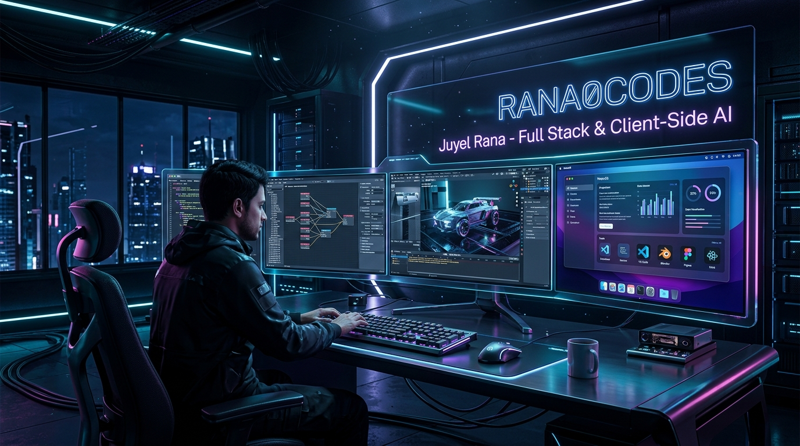
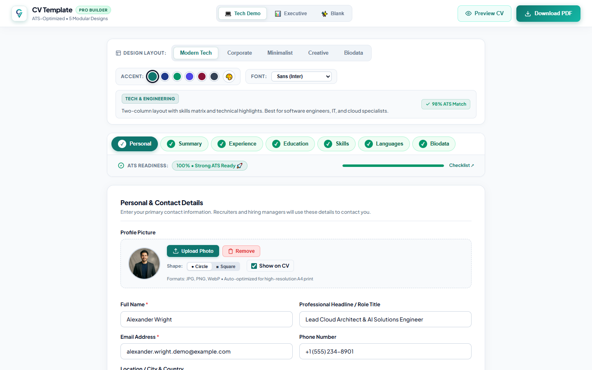
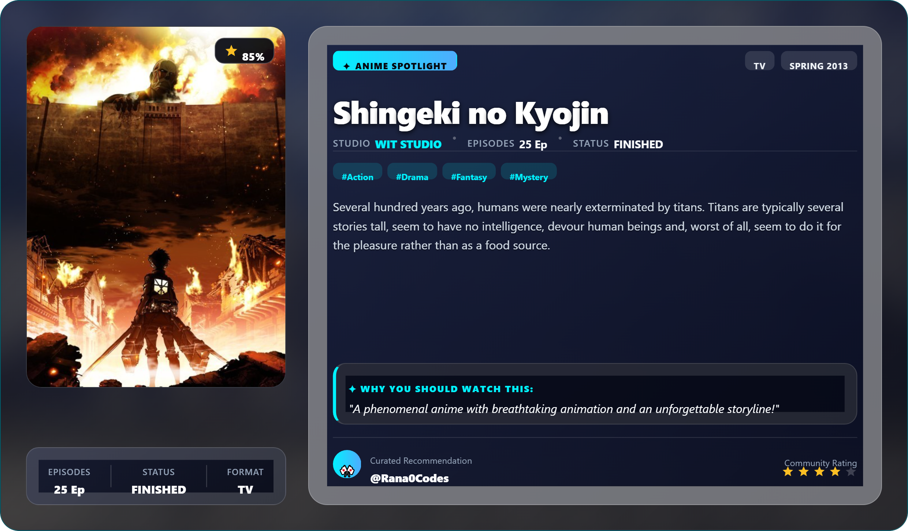
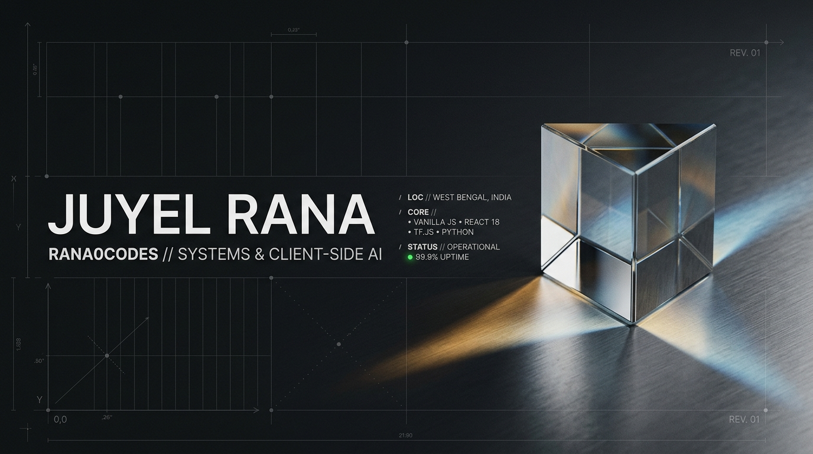
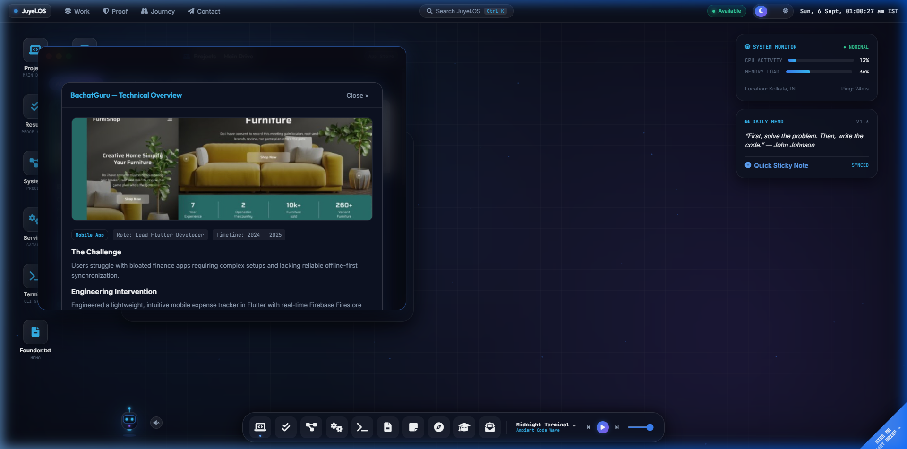

<div align="center">



<br><br>

# Juyel Rana
### `@Rana0Codes` • Full-Stack Software Engineer & Applied AI Builder
**Kolkata, West Bengal, India**

<p align="center">
  <a href="https://rana0codes.github.io/Portfolio-v2/?app=universe3d"></a>
  <a href="https://rana0codes.github.io/Portfolio-v2/"></a>
  <a href="https://www.linkedin.com/in/juyel-rana/"></a>
</p>

> *Architecting privacy-first web utilities, client-side neural vision pipelines, and tactile browser operating systems. Dedicated to verifiable real-world benchmarks, zero runtime bloat, and resilient user-first software.*

</div>

---

<div align="center">

### ⚡ Layer B Gateway: Genuine In-Browser 3D Interactive WebGL Cluster

[](https://rana0codes.github.io/Portfolio-v2/?app=universe3d)

*Experience genuine Three.js 3D celestial nodes, orbital camera controls, interactive raycasting inspection, dynamic dependency splines, and live audio synthesis directly in your browser.*

</div>

---

## 📊 Verified Engineering Benchmarks

| Milestone | Verified Metric | Architectural Scope & Implementation |
| :---: | :---: | :--- |
| ⚡ **16.2–18.4ms** | **Edge AI Inference** | Client-side MobileNetV2 UINT8 WebGL acceleration (`smart-image-document-detector`). |
| 📄 **5 Layouts** | **A4 Vector Print Engine** | Sub-second client-side resume & biodata generation with zero server telemetry (`cv-template`). |
| 🚀 **&lt;300ms** | **GraphQL Query Response** | Real-time AniList API search, theme customization & 1080p poster card export (`Anime Studio`). |
| 🖥️ **60 FPS** | **Browser Desktop Runtime** | Multi-window VisionOS-inspired desktop with Web Audio API synthesis & Three.js WebGL (`Portfolio-v2`). |
| ☁️ **&lt;1s** | **Cloud Sync Latency** | Real-time Firestore document sync with authenticated CRUD console (`Portfolio CMS`). |

---

## 🚀 Featured Project Showcases

<table width="100%">
  <tr>
    <td width="55%" valign="top">
      <h3>1. CV Template & Indian Biodata Studio</h3>
      <p><b>Client-Side Privacy-First Resume and Marriage Biodata Builder</b></p>
      <p>An open-source progressive web application engineered to eliminate predatory subscription paywalls and personal data harvesting. Delivers pixel-perfect vector A4 printing via browser-native paged CSS.</p>
      <ul>
        <li><b>5 Modular Layouts:</b> ATS Single-Column, Indian Biodata, Minimalist Tech, Executive Classic, Creative Sidebar.</li>
        <li><b>Architecture:</b> Vanilla JS (ES6+), Modular CSS3 Print Media, Service Worker PWA, LocalStorage.</li>
        <li><b>Privacy Guarantee:</b> 100% client-side computation; 0 bytes external transmission.</li>
      </ul>
      <p>
        <a href="https://rana0codes.github.io/cv-template/"><b>🔗 Launch Live Builder</b></a> • 
        <a href="https://github.com/Rana0Codes/cv-template"><b>📦 View GitHub Repository</b></a>
      </p>
    </td>
    <td width="45%" align="center" valign="middle">
      <a href="https://rana0codes.github.io/cv-template/">
        
      </a>
    </td>
  </tr>
</table>

<br>

<table width="100%">
  <tr>
    <td width="45%" align="center" valign="middle">
      <a href="https://github.com/Rana0Codes/Anime-Recommendation-Generator">
        
      </a>
    </td>
    <td width="55%" valign="top">
      <h3>2. Anime Recommendation & Poster Studio (v2.0)</h3>
      <p><b>AniList GraphQL Discovery Engine & High-Resolution Card Generator</b></p>
      <p>A fast media curation application engineered with React 18 and Material-UI. Resolves decision fatigue through instant GraphQL queries and generates exportable 1080p promotional cards.</p>
      <ul>
        <li><b>Dynamic Customization:</b> 4 curated themes (Cyberpunk, Onyx, Sakura, Sunset Synthwave) with custom typography.</li>
        <li><b>Export Reliability:</b> High-resolution 1920x1080 canvas export with client-side base64 image proxying to prevent CORS failures.</li>
        <li><b>Tech Stack:</b> React 18, Material-UI (MUI v5), AniList GraphQL, html2canvas, JavaScript ES6+.</li>
      </ul>
      <p>
        <a href="https://github.com/Rana0Codes/Anime-Recommendation-Generator"><b>📦 View GitHub Repository & Architecture</b></a>
      </p>
    </td>
  </tr>
</table>

<br>

<table width="100%">
  <tr>
    <td width="55%" valign="top">
      <h3>3. Portfolio v2 (Juyel.OS) & 3D Project Universe</h3>
      <p><b>Titanium VisionOS Web Desktop & Interactive Three.js WebGL Experience</b></p>
      <p>A multi-window web operating system demonstrating pure web standards mastery. Replaces static portfolio scrolls with interactive task management, procedural audio synthesis, and a 3D celestial cluster.</p>
      <ul>
        <li><b>Interactive 3D Universe:</b> Three.js WebGL space with orbital camera mechanics, raycasting inspection, and dual-mode dependency matrix.</li>
        <li><b>Web Audio Engine:</b> 4 offline lo-fi soundscapes paired with a real-time 4-bar FFT frequency spectrum visualizer.</li>
        <li><b>Zero-Framework Purity:</b> 100% Vanilla JS ES6+ modules with glassmorphic CSS3; 0 build tool dependencies.</li>
      </ul>
      <p>
        <a href="https://rana0codes.github.io/Portfolio-v2/?app=universe3d"><b>🪐 Launch in 3D WebGL</b></a> • 
        <a href="https://rana0codes.github.io/Portfolio-v2/"><b>🖥️ Open Web Desktop</b></a> • 
        <a href="https://github.com/Rana0Codes/Portfolio-v2"><b>📦 GitHub Repository</b></a>
      </p>
    </td>
    <td width="45%" align="center" valign="middle">
      <a href="https://rana0codes.github.io/Portfolio-v2/">
        
      </a>
    </td>
  </tr>
</table>

<br>

<table width="100%">
  <tr>
    <td width="45%" align="center" valign="middle">
      <a href="https://github.com/Rana0Codes/smart-image-document-detector">
        
      </a>
    </td>
    <td width="55%" valign="top">
      <h3>4. Smart Image & Document Classifier</h3>
      <p><b>In-Browser Edge AI Document Detection with MobileNetV2 & TensorFlow.js</b></p>
      <p>A privacy-preserving neural classification system designed for zero-latency client-side document sorting. Eliminates cloud upload latency and server inference overhead.</p>
      <ul>
        <li><b>Model Optimization:</b> Fine-tuned MobileNetV2 with UINT8 quantization (8.8 MB → 2.4 MB) achieving 16.2–18.4ms steady-state WebGL inference.</li>
        <li><b>Verified Accuracy:</b> Evaluated on diverse document and photographic datasets with documented error boundaries on laminated identity cards.</li>
        <li><b>Tech Stack:</b> Python, TensorFlow.js, MobileNetV2, WebGL Shader Pipeline, HTML5 Canvas.</li>
      </ul>
      <p>
        <a href="https://github.com/Rana0Codes/smart-image-document-detector"><b>📦 View Repository & Empirical Benchmarks</b></a>
      </p>
    </td>
  </tr>
</table>

<br>

<table width="100%">
  <tr>
    <td width="55%" valign="top">
      <h3>5. Full-Stack Portfolio & CMS Console</h3>
      <p><b>Dynamic Web Engine Powered by Google Firebase & Firestore</b></p>
      <p>An authenticated web platform enabling instant case study publishing, project metadata management, and encrypted contact dispatch without rebuilding static site files.</p>
      <ul>
        <li><b>Security Architecture:</b> Granular Firestore security rules enforcing public read access and schema-validated administrative writes.</li>
        <li><b>Integration:</b> Real-time Firestore snapshot listeners, Google Firebase Authentication, and Web3Forms spam filtering.</li>
        <li><b>Tech Stack:</b> JavaScript ES6+, Cloud Firestore, Firebase Auth, Web3Forms, GSAP Motion.</li>
      </ul>
      <p>
        <a href="https://rana0codes.github.io/Portfolio/"><b>🔗 Launch Live Portfolio</b></a> • 
        <a href="https://github.com/Rana0Codes/Portfolio"><b>📦 GitHub Repository</b></a>
      </p>
    </td>
    <td width="45%" align="center" valign="middle">
      <a href="https://rana0codes.github.io/Portfolio/">
        
      </a>
    </td>
  </tr>
</table>

---

## 🛠️ Technical Competency Matrix

```text
┌───────────────────────────┬────────────────────────────────────────────────────────────────────────┐
│ DOMAIN                    │ TECHNOLOGIES & TOOLS IN PRODUCTION                                     │
├───────────────────────────┼────────────────────────────────────────────────────────────────────────┤
│ Frontend Engineering      │ Vanilla JavaScript (ES6+), React 18, HTML5 Paged Media, Vite, PWA      │
│ Styling & Motion          │ Glassmorphic CSS3, Material-UI (v5), Tailwind CSS, GSAP Motion         │
│ Applied AI & Vision       │ TensorFlow.js, Python, MobileNetV2, UINT8 Quantization, Edge AI        │
│ 3D & Audio Graphics       │ Three.js (WebGL), Web Audio API (FFT Analyser), HTML5 Canvas 2D/3D     │
│ Cloud, APIs & Database    │ Cloud Firestore, Firebase Auth, GraphQL (AniList), Web3Forms, REST APIs│
│ DevOps & Quality Assur.   │ Git CLI, GitHub Pages, Chrome DevTools, Lighthouse, WCAG Accessibility │
└───────────────────────────┴────────────────────────────────────────────────────────────────────────┘
```

---

## 🧭 Engineering Principles

- **Privacy-First by Architecture:** Keeping processing on the client machine whenever feasible (in-browser neural vision, client-side vector printing).
- **Zero Runtime Waste:** Choosing standard web primitives (Vanilla JS, Canvas, Web Audio) to achieve 60 FPS performance without framework dependency weight.
- **Empirical Transparency:** Documenting real measured latencies, memory footprints, and known edge-case boundaries rather than unsubstantiated claims.

---

## 📬 Professional Contact & Links

- **Interactive 3D Experience:** [Launch 3D Universe (`rana0codes.github.io/Portfolio-v2/?app=universe3d`)](https://rana0codes.github.io/Portfolio-v2/?app=universe3d)
- **Titanium Web Desktop:** [Explore Juyel.OS (`rana0codes.github.io/Portfolio-v2`)](https://rana0codes.github.io/Portfolio-v2/)
- **LinkedIn Profile:** [linkedin.com/in/juyel-rana](https://www.linkedin.com/in/juyel-rana/)
- **Direct Email:** [ranajuyel460@gmail.com](mailto:ranajuyel460@gmail.com)
- **WhatsApp Inquiries:** [+91 7679862322](https://wa.me/917679862322)

---

<div align="center">
  <sub>Designed & engineered for <b><a href="https://github.com/Rana0Codes">@Rana0Codes</a></b> • Juyel Rana • Verified October 2026</sub>
</div>
